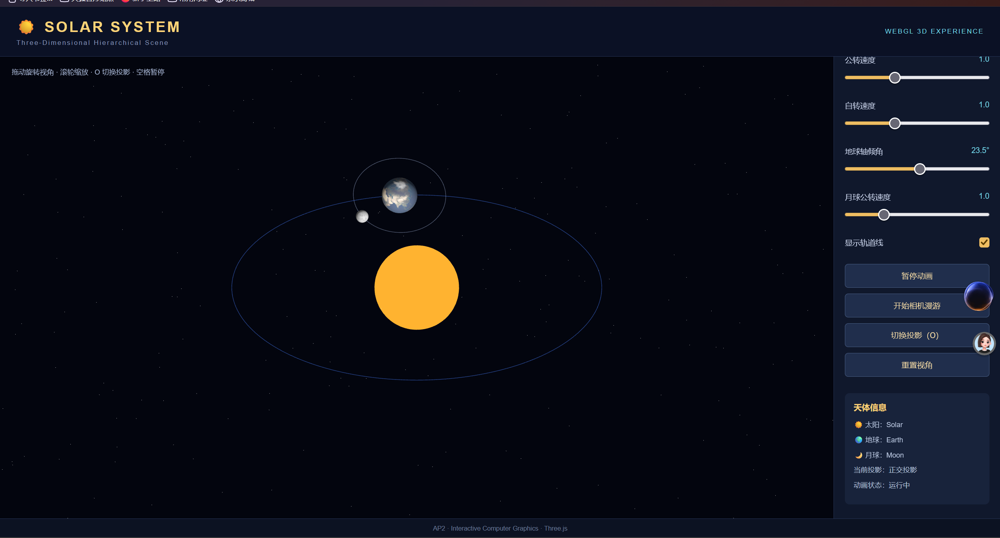
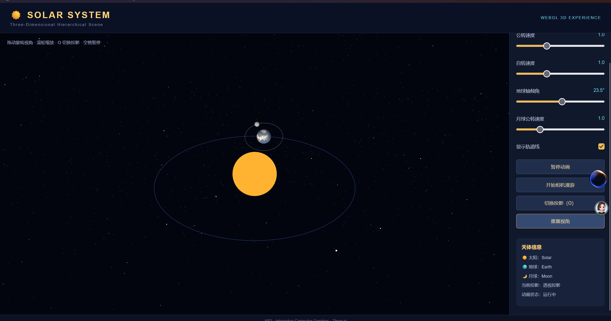

# AP2：三维层次场景——太阳系

## 一、项目简介

本项目为三维太阳系模拟系统，使用 JavaScript 和 Three.js 构建三维场景，实现太阳、地球和月球的层次结构及运动效果。

项目主要运用三维变换、层次建模、纹理映射、相机与投影等相关知识，实现天体自转、公转、相机漫游和交互控制等功能。

## 二、项目文件结构


AP2-Solar-System/
├── index.html       # 网页入口及界面结构
├── main.js          # Three.js 场景及交互逻辑
├── style.css        # 页面样式
├── images/          # 项目运行截图
│   ├── solar-system.png
│   ├── interaction.png
│   ├── orthographic.png
│   └── perspective.png
├── videos/          # 相机漫游录屏
│   └── camera-roaming.mp4
└── README.md        # 项目说明文档


## 三、项目运行说明

### 1. 运行环境

- 开发工具：Visual Studio Code
- 开发语言：JavaScript
- 3D 图形库：Three.js（版本 0.160.0）
- 浏览器：支持 WebGL 的现代浏览器
- 运行方式：本地静态服务器

### 2. 运行步骤

1. 使用 VS Code 打开项目文件夹。
2. 启动 Live Server 或其他本地静态服务器。
3. 在浏览器中打开服务器提供的地址。
4. 等待场景初始化完成，即可看到太阳系三维场景。

项目通过 CDN 加载 Three.js 及 OrbitControls 模块，运行时需要网络连接。

## 四、三维场景与层次结构

### 1. 场景构建

项目使用 Three.js 创建三维场景、相机和 WebGL 渲染器。

场景主要包括：
- 太阳、地球和月球三个球体。
- 太阳光源及环境光。
- 地球公转轨道和月球公转轨道。
- 星空背景。
- 相机及用户交互控制。

### 2. 层次结构

项目采用 Group 组织天体之间的父子关系，形成三层层次变换结构。

层次结构如下：


Scene
│
├── Sun（太阳）
│
├── EarthOrbit（地球公转节点）
│   │
│   └── EarthTilt（地球倾斜及位置节点）
│       │
│       ├── Earth（地球）
│       │
│       └── MoonOrbit（月球公转节点）
│           │
│           └── MoonTilt（月球位置节点）
│               │
│               └── Moon（月球）
│
├── EarthOrbitLine（地球轨道线）
└── Stars（星空背景）


其中：
- 太阳位于场景中心。
- 地球通过 EarthOrbit 节点实现围绕太阳公转。
- 地球通过自身 rotation.y 实现自转。
- 月球通过 MoonOrbit 节点实现围绕地球公转。
- 月球也具有独立的自转效果。

通过父子节点的变换继承，实现了天体之间的层次运动关系。

### 3. 地球自转轴倾角

项目将地球初始自转轴倾角设置为 23.5°。

通过 EarthTilt 节点的旋转实现地球轴向倾斜：


earthTilt.rotation.z = THREE.MathUtils.degToRad(tiltAngle);


其中，倾角可以通过控制面板中的滑块进行调整。

地球倾斜变换作用于 EarthTilt 节点，其子节点地球和月球轨道也会继承该节点的变换。

## 五、手动矩阵构造与变换

### 1. 矩阵构造

项目在月球轨道运动中使用 Three.js 的 Matrix4 对象手动组合旋转矩阵。

主要代码如下：

```javascript
const moonOrbitMatrix = new THREE.Matrix4();

function updateMoonMatrix(angle = 0) {
    const rotationX = new THREE.Matrix4().makeRotationX(
        THREE.MathUtils.degToRad(5)
    );

    const rotationY = new THREE.Matrix4().makeRotationY(angle);

    moonOrbitMatrix.multiplyMatrices(rotationY, rotationX);

    moonOrbit.matrixAutoUpdate = false;
    moonOrbit.matrix.copy(moonOrbitMatrix);
    moonOrbit.matrixWorldNeedsUpdate = true;
}
```

### 2. 变换原理

首先，使用 makeRotationX 构造绕 X 轴旋转 5° 的旋转矩阵。

其次，使用 makeRotationY 构造绕 Y 轴旋转的矩阵，其旋转角度随动画时间变化。

然后，通过 multiplyMatrices 将两个旋转矩阵进行组合：

```javascript
moonOrbitMatrix.multiplyMatrices(rotationY, rotationX);
```

最后，将组合后的矩阵赋值给月球公转节点，关闭该节点的自动矩阵更新，使月球轨道按照手动组合的矩阵进行变换。

通过矩阵组合，实现月球轨道倾斜与旋转的效果。

**说明：本项目使用 Three.js Matrix4 完成手动矩阵组合。**

## 六、纹理映射

### 1. 纹理加载

项目使用 Three.js 的 TextureLoader 加载太阳、地球和月球的纹理图片。

对应纹理资源：

| 天体 | 纹理资源 |
|---|---|
| 太阳 | sun.jpg |
| 地球 | earth_atmos_2048.jpg |
| 月球 | moon_1024.jpg |

纹理通过以下方式加载：

```javascript
const textureLoader = new THREE.TextureLoader();

textureLoader.load(url, texture => {
    // 纹理加载成功
});
```

### 2. 纹理应用

项目使用 SphereGeometry 创建球体几何体，并通过 MeshStandardMaterial 的 map 属性将纹理应用到球体表面。

```javascript
const material = new THREE.MeshStandardMaterial({
    map: texture,
    roughness: 0.9
});
```

太阳、地球和月球分别使用对应的纹理，使不同天体具有不同的表面视觉效果。

### 3. 纹理加载异常处理

为避免网络加载失败影响场景运行，项目设置了备用纹理。

当纹理加载失败或超过等待时间时，程序会使用 CanvasTexture 创建的纯色纹理代替，并通过控制台输出提示信息。

### 4. 纹理方向说明

项目使用 Three.js 的 TextureLoader 和 SphereGeometry 完成纹理加载与纹理坐标映射。

纹理图像的方向由 Three.js 的纹理处理机制及几何体 UV 坐标共同决定。本项目没有在业务代码中直接编写 gl.texImage2D 或手动设置 UV 属性。

## 七、投影方式与相机控制

### 1. 透视投影

项目初始使用 PerspectiveCamera 创建透视相机。

透视投影具有近大远小的特点，物体的视觉大小会随其与相机之间的距离变化。

### 2. 正交投影

项目通过 OrthographicCamera 创建正交相机。

正交投影下，物体不会因为距离相机远近而改变投影大小，平行线在投影中仍保持平行。

### 3. 投影切换

项目通过 switchProjection() 函数实现两种投影方式之间的切换。

用户可以通过控制面板中的投影切换按钮，或键盘 O 键完成切换。

切换时，程序会保留原相机的位置，并重新创建 OrbitControls，使场景继续支持视角控制。

### 4. 正交投影效果



### 5. 透视投影效果



### 6. 相机漫游

项目提供预设路径的相机环绕漫游功能。

相机按照时间参数计算位置，使相机围绕太阳系场景进行环绕运动。

通过控制面板中的相机漫游按钮，可以开始或停止漫游。

漫游过程中，鼠标轨道控制会暂时关闭；停止漫游后，可以重新使用鼠标拖动调整观察视角。

通过 Space 键可以暂停或恢复动画时间，因此也会暂停或恢复基于该时间参数的相机漫游。

### 7. 相机漫游录屏

以下为项目相机漫游效果录屏：

[点击观看相机漫游录屏](videos/camera-roaming.mp4)

## 八、交互功能

项目设置了控制面板和键盘操作，具体功能如下：

| 交互方式 | 功能 |
|---|---|
| O 键 | 切换正交投影与透视投影 |
| Space 键 | 暂停或恢复动画 |
| 公转速度滑块 | 调整地球公转速度 |
| 自转速度滑块 | 调整天体自转速度 |
| 月球速度滑块 | 调整月球公转速度 |
| 轴向倾角滑块 | 调整地球自转轴倾角 |
| 轨道线复选框 | 显示或隐藏轨道线 |
| 相机漫游按钮 | 开始或停止相机环绕漫游 |
| 投影切换按钮 | 切换正交投影与透视投影 |
| 重置视角按钮 | 恢复相机初始观察位置 |
| 鼠标拖动 | 调整场景观察视角 |


## 九、项目总结

本项目通过 Three.js 实现了太阳、地球和月球组成的三维太阳系层次场景。

在项目实现过程中，运用了 Group 层次结构、三维旋转变换、矩阵组合、纹理映射、正交投影与透视投影，以及相机控制等知识。

同时，通过控制面板和键盘事件实现了场景参数调整、投影切换、动画暂停和相机漫游等交互功能。

通过本次实践，加深了对三维场景层次建模、变换关系和相机投影原理的理解。